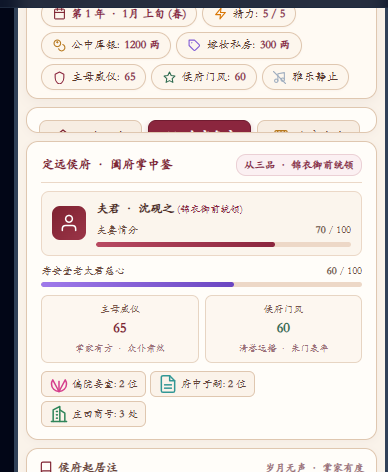

# 🎮 东方叙事与模拟经营 · 原生单文件游戏矩阵
> **Zero-Dependency Web Game Matrix**  
> 纯原生单文件（Zero-Dependency HTML）架构 · 双击即玩 · 无需编译 · 零外部网络依赖 · 永久离线可玩

[](https://developer.mozilla.org/zh-CN/docs/Web/HTML)
[](https://developer.mozilla.org/zh-CN/docs/Web/JavaScript)
[](https://developer.mozilla.org/zh-CN/docs/Web/API/Web_Audio_API)
[-success)](#-技术架构与设计哲学)
[](LICENSE)

---

## 🌐 在线试玩与公网访问直达 (Live Demo)

无论是否安装开发环境，均可通过以下公网链接**直接在手机或电脑浏览器中点击即玩**：

| 游戏 / 展示大厅 | 题材与特色 | GitHub Pages 线上直达 | 云端官方即时镜像 (免等待) |
| :--- | :--- | :---: | :---: |
| 🌐 **矩阵展示控制台 (Showcase Hub)** | 五大矩阵总览、一键直玩、批量导出 | [🔗 点击直达大厅](https://longsongline.github.io/-1/) | [⚡ 点击直达大厅](https://ais-pre-ieeqszp7uvvdvtjkrl4d54-606544057259.us-east1.run.app) |
| 🛡️ **《方舟纪元 · 废土避难所》 (58KB 末日新作)** | 废土末日 · 避难所经营 · 水培温室 · 忠犬相伴 · 四大希望终局 | [👉 点击直接玩](https://longsongline.github.io/-1/shelter.html) | [⚡ 点击直接玩](https://ais-pre-ieeqszp7uvvdvtjkrl4d54-606544057259.us-east1.run.app/shelter.html) |
| 🪭 **《高门主母掌家录》 (120KB 典藏版)** | 古代世家 · 执掌中馈 · 四时雅趣 · 闺阁女红 · 白狮猫雪球 | [👉 点击直接玩](https://longsongline.github.io/-1/gaomen.html) | [⚡ 点击直接玩](https://ais-pre-ieeqszp7uvvdvtjkrl4d54-606544057259.us-east1.run.app/gaomen.html) |
| 🌸 **《修真经营录》 (113KB 仙途版)** | 东方修仙 · 神农鼎炼丹 · 后山灵兽狐鸾 · 八大蓝颜清谈情笺 | [👉 点击直接玩](https://longsongline.github.io/-1/xiuxian_female.html) | [⚡ 点击直接玩](https://ais-pre-ieeqszp7uvvdvtjkrl4d54-606544057259.us-east1.run.app/xiuxian_female.html) |
| 🏙️ **《滨江市 · 打工人生》 (117KB 逆袭版)** | 现代都市 · 出租屋软装 · 流浪萌宠 · 故乡家书包裹 · 深夜馄饨 | [👉 点击直接玩](https://longsongline.github.io/-1/binjiang.html) | [⚡ 点击直接玩](https://ais-pre-ieeqszp7uvvdvtjkrl4d54-606544057259.us-east1.run.app/binjiang.html) |
| 🌾 **《桃花村 · 田园经营》 (267KB 治愈版)** | 古典乡村 · 躬耕避世 · 柴米油盐 · 四时农桑 · 乡土温情 | [👉 点击直接玩](https://longsongline.github.io/-1/assets/aistudio/tianyuan_cae35171.html) | [⚡ 点击直接玩](https://ais-pre-ieeqszp7uvvdvtjkrl4d54-606544057259.us-east1.run.app/assets/aistudio/tianyuan_cae35171.html) |

---

## 📸 实机内容精选截图

### 🪭《古代世家 · 高门主母掌家录》实机界面

<div align="center">
  <table border="0">
    <tr>
      <td align="center" width="50%">
        <b>正堂公中 · 晨省点卯与发落例银</b><br/><br/>
        
      </td>
      <td align="center" width="50%">
        <b>闺府中枢 · 夫君情分与起居注</b><br/><br/>
        
      </td>
    </tr>
  </table>
</div>

> **设计特色**：
> 1. **双端自适应交互**：桌面端呈现宽屏双栏决策台，手机端自动启用专属「掌家中枢 / 侯府起居注」双屏无缝切换，彻底解决移动端截断问题；
> 2. **宋锦高对比工笔字族**：深栗红黑高对比度配色搭配 CJK 抗锯齿无衬线字体，字字清晰悦目；
> 3. **全量精细内嵌矢量 SVG**：每一个行动按钮、属性徽章均采用 100% 纯代码矢量渲染，绝无粗糙模糊与重复图标。

---

## 🌟 项目简介

本项目收录了 **四款极具差异化与沉浸感** 的现代与古代题材文字模拟经营独立游戏。所有作品均采用 **纯原生单文件（Single-File HTML）** 架构开发，将 HTML 结构、CSS3 样式体系、全量精细矢量 SVG 图标、Web Audio 实时和弦合成音效引擎与完整游戏状态机全部封装在 **单个独立 HTML 文件** 内。

无需安装 Node.js、无需运行编译构建脚本、无需联网加载任何第三方 CDN 或图片音频资源。**直接双击文件，即可在任何现代浏览器中畅玩！**

---

## 🏰 五大收录作品概览

| 封面 / 标志 | 作品名称 | 题材背景 | 代码体量 | 单文件路径 | 核心特色系统 |
| :---: | :--- | :--- | :---: | :--- | :--- |
| 🛡️ | **《方舟纪元 · 废土避难所》** | 废土末日 · 避难所经营 | **58 KB** (1,357行) | `public/shelter.html` | 第101号避难所经营、无土水培温室自给、后厨浓汤、柴油机组工坊检修、4大个性幸存者、忠犬黑子陪伴解压、短波电台商队、四大希望终局 |
| 🪭 | **《古代世家 · 高门主母掌家录》** | 古代世家 · 高门中馈 | **118 KB** (1,905行) | `public/gaomen.html` | 六大中馈权力中枢、四时雅趣小膳房手作（夏制冰碗/冬烹雪茶）、锦绣百宝女红绣房（同心荷包/玄狐大氅/长命锁）、御赐异瞳白狮猫「雪球」陪伴寻宝、膝前伴读讲古、殿试探花郎、6大传世终局长卷 |
| 🌸 | **《修真经营录》** | 东方修仙 · 宗门仙途 | **110 KB** (1,973行) | `public/xiuxian_female.html` | 神农古鼎自由配方炼丹工坊（控火出极品丹纹）、后山萌宠灵兽仙苑（九尾雪狐白团儿/赤金青鸾啾啾）、8位倾心绝色蓝颜（踏月清谈/飞剑传书情笺）、六大珍稀仙草多田开辟、洞府烹茶抚琴、深情治愈病榻娘亲 |
| 🏙️ | **《滨江市 · 打工人生》** | 现代都市 · 生存逆袭 | **120 KB** (2,098行) | `public/binjiang.html` | 温馨出租屋软装装扮（落日灯/懒人沙发/巨幕投影/黑胶唱片）、流浪萌宠治愈陪伴（吸猫踩奶/喂纯肉罐头/宠物SPA）、故乡父母亲情家书与老家手工水饺腊肉包裹、深夜老李柴火小馄饨摊、伴侣浪漫烛光生活 |
| 🌾 | **《桃花村 · 古代田园经营》** | 古典乡村 · 四时农桑 | **267 KB** (4,699行) | `public/assets/aistudio/tianyuan_cae35171.html` | 四时节气流转、五亩良田耕种、老母侍疾抓药、赶集经商、幼子科举入仕、全村民温情支线 |

---

## 📖 作品精微解构

### 1. 🪭《古代世家 · 高门主母掌家录》 (`public/gaomen.html`)
> **“一柄金错匙，掌尽侯府百年荣枯；三尺戒尺下，立稳高门主母威仪。”**

- **背景设定**：主角承命嫁入定远侯府，成为正头大娘子（金陵谢氏锦仪）。内有得宠妾室林小娘、心机寄居表妹柳纤纤，外有夫君沈砚之（从三品锦衣御前统领）官场浮沉与京城命妇名利场。
- **全新核心系统 (118KB 典藏扩充版)**：
  - **后花园 · 四时雅趣小膳房**：春酿桃花酒、夏制酥酪冰碗与碧筒荷花酥、秋烹金桂冬酿与糖渍板栗、冬扫红梅新雪烹松针茶。可呈奉外书房红袖添香（夫妻情分暴涨）、敬献寿安堂孝顺婆母（赏赐南洋珍珠）、分赐各房姨娘恩威并施！
  - **锦绣百宝 · 闺阁女红绣房**：飞针走线绣双面苏绣同心荷包（夫君佩戴官声大噪）、缝玄狐皮滚边蜀锦大氅（严冬御寒动情契阔）、纳金线百衲长命锁（保佑儿女聪敏无灾）、织紫貂暖额孝敬老太君。
  - **庭院灵宠 · 御赐波斯异瞳白狮猫「雪球」**：抱膝揉毛顺毛呼噜（解压治愈恢复精力）、赏赐小膳房鲜蒸银鱼羹、放它后花园捕蝶扑花，雪球还能从太湖石丛衔回遗落的金簪与密信！
  - **世家儿女 · 膝前伴读与慈母讲古**：亲手握着稚子小手描红大字、雨夜掖被讲述先祖忠烈往事、延聘翰林大儒与禁军武师傅，长子沈怀瑾金榜题名高中探花郎，四世同堂！
  - **正堂公中与内宅掌权**：晨起升座点卯、发落例银、外书房对弈、敲打处置寄宿表妹柳纤纤、突击搜查倚翠阁违禁暗格。
  - **家规裁决与朝堂大劫**：【皇子夺嫡密帖】、【御前救夫鸣冤翻盘】以及 6 大传世结局长卷。

---

### 2. 🌸《修真经营录》 (`public/xiuxian_female.html`)
> **“仙途漫漫何所求？偷得浮生半日闲。八位蓝颜倾心伴，神农丹道叩九霄。”**

- **全新核心系统 (110KB 仙途典藏版)**：
  - **神农古鼎 · 自由配方古法炼丹工坊**：研磨洗髓草、凝霜花、千年何首乌、九叶紫芝、纯阳朱果、七宝金莲、晨露与地火精华！自由挑选【文火慢温】或【武火爆炼】，暴击触发【紫气东来 · 丹纹生云】极品绝世丹药！
  - **后山萌宠 · 灵兽仙苑**：收养九尾雪狐（白团儿）与赤金青鸾（啾啾）！温柔顺毛吸狐踩奶、投喂仙果灵草、白团儿巡山寻宝叼回稀有珍宝种子，青鸾还能凌空衔书传情！
  - **8位绝色蓝颜 · 踏月清谈与飞剑情笺**：清冷白衣师尊顾长生、忠犬重剑影卫赵无咎、邪魅狂放魔尊夜幽冥、温润太子萧景煜等，不仅拥有长篇小说级专属主线，更增设【踏月清谈浪漫约会】与【个性化飞剑情笺手札】！
  - **灵田扩建与四季烹茶**：支持开辟最多8亩高阶灵田，洞府雅室烹茶抚琴洗涤道心，深情救治病榻娘亲！

---

### 3. 🏙️《滨江市 · 打工人生》 (`public/binjiang.html`)
> **“从城中村合租房到滨江国金中心，家与爱是打工人最坚硬的铠甲。”**

- **全新核心系统 (120KB 治愈逆袭版)**：
  - **温馨出租屋软装装扮**：亲手挑选布置暖光落日灯、羊羔绒厚地毯与懒人沙发、智能空气炸锅、4K巨幕家用投影仪、阳台治愈多肉架与复古黑胶唱片机，每种软装提供专属治愈恢复加成！
  - **治愈流浪萌宠深度陪伴**：领养田园橘猫或小狗，沉浸揉肚子吸猫踩奶、投喂营养纯肉主食罐头、逗猫棒追逐嬉闹、居家宠物SPA香波洗护，瞬间化解大城市打拼的疲惫与焦虑！
  - **故乡与恩人亲情系统**：给老家父母打电话听妈妈唠叨、拆开老家寄来的沉甸甸手工水饺与柴火腊肉大邮包、向老家孝敬汇款、休假探亲围炉吃团圆饭！
  - **街角深夜老李柴火小馄饨摊**：加班深夜坐在街角小马扎上，吃一碗热气腾腾骨汤馄饨，听市井长谈，温暖治愈！
  - **伴侣浪漫烛光生活与大厂逆袭**：烛光温存、江边散步，生儿育女见证全代际传承，打拼实业创立连锁公司！

---

### 4. 🌾《桃花村 · 古代田园经营》 (`public/assets/aistudio/tianyuan_cae35171.html`)
> **“开荒南野际，守拙归园田。柴米油盐寻常事，岁岁平安胜万钱。”**

- **核心系统**：
  - 四时节气流转（春耕、夏耘、秋收、冬藏），降雨与旱涝天象。
  - 农事耕作、市集赶场、药铺抓药、乡邻人情往来。
  - 养育子女开蒙入塾，供养儿女考取功名，享受三代同堂天伦之乐。

---

### 5. 🛡️《方舟纪元 · 废土避难所》 (`public/shelter.html`)
> **“文明的余烬终将熄灭，但人性的微光，在地下深处永不沉沦。”**

- **全新核心系统 (58KB 末日新作)**：
  - **避难所水培温室自给自足**：无土培育抗辐射番茄、变异高产马铃薯与发光雪蘑菇，定期喷淋净化营养液，自给自足抵抗地表恶性辐射饥荒。
  - **后厨人间烟火与工坊检修**：红砖柴火炉熬煮浓香土豆午餐肉汤抚慰全员身心；机械工坊定期检修地热柴油发电机组防断电、更换高分子防爆空气滤芯、加固合金铅门。
  - **四位个性同伴与忠犬黑子**：机械天才少女安娜（手弹电吉他演唱战前民谣）、退役老军医老陈（传授野战急救心得）、荒野猎人雷诺（带领外出搜荒探险）、废墟遗孤小妹妹小朵（水培温室帮手与儿歌暖心）；顺毛揉揉大德牧黑子肚皮，驱散末日严酷焦虑！
  - **大地图废墟搜荒与短波电台**：搜寻废弃红星超市、仁爱综合医院、电子厂与伏击匪帮车辆；调频电台搜寻幸存者、接待双头骆驼游商贸易、响应暴风雪难民紧急求救。
  - **四大希望终局**：【大地回春 · 绿色新伊甸】、【废土灯塔 · 辐射万人城】、【星海重燃 · 飞向深空】、【炉边微光 · 岁月静好】。

---

## 🛠️ 技术架构与设计哲学

```text
               ┌────────────────────────────────────────────────────────┐
               │            纯原生单文件 (Zero-Dependency HTML)          │
               ├──────────────────────────┬─────────────────────────────┤
               │       HTML5 语义骨架      │     原生 CSS3 响应式系统      │
               │  • 语义化容器与无障碍结构   │  • 现代无衬线高清晰中文字族   │
               │  • 移动端/桌面端视口自适应  │  • 古典宋锦色盘与高对比度排版 │
               ├──────────────────────────┼─────────────────────────────┤
               │   全量精细内嵌矢量 SVG    │    Web Audio API 实时合成   │
               │  • 100% 纯代码矢量绘制   │  • 宫调五声音阶振荡器算法   │
               │  • 零外部图片请求/免占带宽│  • 无需外部 mp3/ogg 音频资源│
               ├──────────────────────────┼─────────────────────────────┤
               │    ES6+ 原生状态机引擎    │      安全与离线持久化机制   │
               │  • 单向数据流与自适应渲染 │  • 深度防 F12 / 反调试锁    │
               │  • 纯原生 DOM 操作高性能 │  • LocalStorage 多卷宗存档  │
               └──────────────────────────┴─────────────────────────────┘
```

1. **零外部网络依赖（Zero-CDN）**：
   不依赖 Google Fonts、Tailwind CDN、FontAwesome、jQuery、Vue 或 React 运行时。即使在完全断网的环境下，依然可以 100% 正常运行。
2. **极速分发与秒开**：
   单文件仅需复制发送即可畅玩，无任何外部资源丢失风险，首屏加载通常小于 30ms。
3. **原生 Web Audio API**：
   利用浏览器底层的 `AudioContext` 实时产生正弦波与三角波振荡，配合衰减包络曲线合成清丽的宫廷古筝音效。
4. **安全保护与神识存档**：
   内置右键拦截、DevTools 快捷键屏蔽与动态反调试保护；基于 `localStorage` 支持自动档与 3 卷宗室手工存简。

---

## 🚀 本地快速运行指南

### 方法一：直接双击运行（最简方式）
在文件管理器中找到 `.html` 文件，双击使用任意现代浏览器打开即可：

```bash
# Windows
start public/gaomen.html

# macOS
open public/gaomen.html

# Linux
xdg-open public/gaomen.html
```

---

### 方法二：使用极简静态服务器
```bash
# 使用 npx serve
npx serve public

# 或使用 Python 内置服务器
cd public && python3 -m http.server 8080
```
浏览器访问 `http://localhost:8080/gaomen.html` 即可畅玩。

---

### 方法三：启动综合 React 展示大厅控制台
本项目根目录配备了基于 React 18 + Vite + Tailwind CSS 的矩阵展示大厅：

```bash
# 1. 安装依赖
npm install --legacy-peer-deps

# 2. 启动开发展示服务器
npm run dev
```
打开 `http://localhost:3000` 即可进入矩阵展示控制台。

---

## 🚢 GitHub Pages 自动部署指南

本项目已内置自动化构建流 `.github/workflows/static.yml`，推送到 GitHub 后可开启全自动公网发布：

1. 进入 GitHub 仓库设置：`Settings` -> `Pages`；
2. 在 **Build and deployment** 下方的 **Source** 中选择 **`GitHub Actions`**；
3. 每次推送到 `main` 分支，GitHub 会自动构建并在 1 分钟内完成上线；
4. 公网访问地址格式：
   - 首页大厅：`https://<用户名>.github.io/<仓库名>/`
   - 主母掌家录：`https://<用户名>.github.io/<仓库名>/gaomen.html`
   - 修真经营录：`https://<用户名>.github.io/<仓库名>/xiuxian_female.html`
   - 滨江打工人生：`https://<用户名>.github.io/<仓库名>/binjiang.html`

---

## 📄 开源许可证

本项目基于 [MIT 许可证](LICENSE) 开源，欢迎自由交流、学习、二创及商业灵感参考。  
*由衷感谢每一位热爱文字模拟与独立经营叙事的开发者与玩家！*
